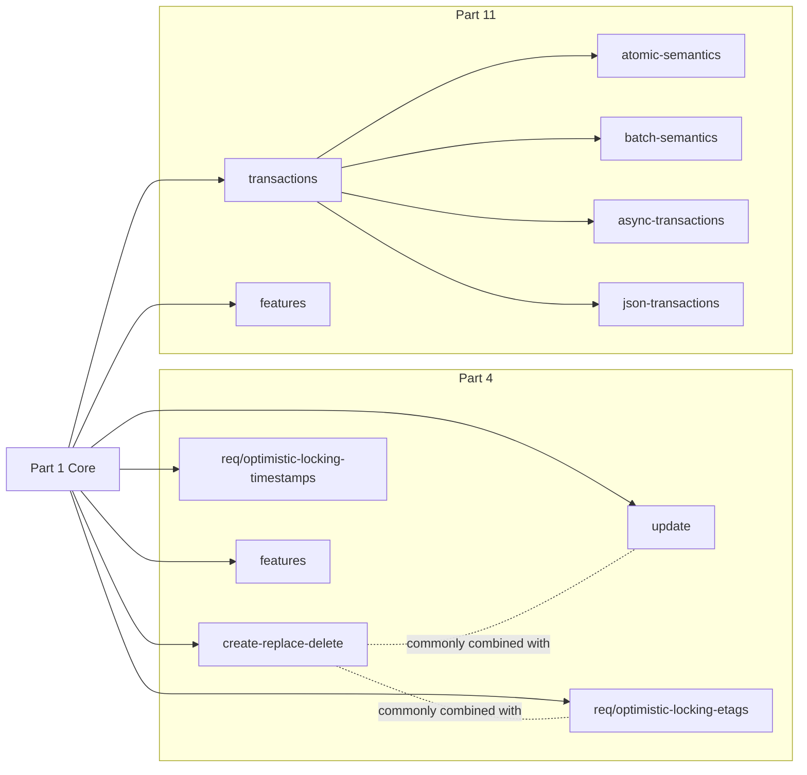

# OGC API - Features (Parts 4, 5 & 11)

Reference and workflow for implementing and validating OGC API - Features write operations and collection schemas.
Backend- and framework-agnostic; use the relevant part for the capability being considered.

## Scope

| Part | What it covers | Governing text |
|------|----------------|----------------|
| 4 — Create, Replace, Update and Delete | `POST`, `PUT`, `PATCH`, and `DELETE` on individual feature resources; no side effects on other resources. | [Part 4 draft](https://docs.ogc.org/DRAFTS/20-002r1.html) and [CRUD reference](./references/part-4-crud.md) |
| 5 — Schemas (also OGC API - Common - Part 3) | Logical collection schemas represented using JSON Schema; resources for returnable, receivable, queryable, and sortable properties; profiles, including representations of references. | [Part 5 editor's draft](https://docs.ogc.org/DRAFTS/23-058r3.html) and [schemas reference](./references/part-5-schemas.md) |
| 11 — Atomic and Batch Transactions | A `/transactions` endpoint for multiple operations; atomic (all-or-nothing) or batch (partial-success) semantics. | [Part 11 draft](https://docs.ogc.org/DRAFTS/23-057r1.html); not yet independently verified in this skill |

Part 5 lets clients discover which properties can be returned, submitted, filtered, or sorted, and request supported profiles—for example, a parcel reference as an ID, URI, or labeled link.

Part 4 and Part 11 assume conformance to the relevant foundations (out of scope here):

- Part 1 — Core: <http://docs.ogc.org/is/17-069r4/17-069r4.html>
- Part 2 — CRS by Reference: <http://docs.ogc.org/is/18-058r1/18-058.html>

**Conformance URIs are opaque identifiers** — not resolvable URLs.
Exact character spelling is what matters for conformance; do not "fix" them.

The following diagram covers the existing Part 4 and Part 11 write-operation classes, not Part 5 schema classes.

## When to Use

Load this skill when the user is:

1. Adding or changing any endpoint that creates, replaces, updates, or deletes features (typically `POST` / `PUT` / `PATCH` / `DELETE` on `/collections/{collectionId}/items` or `/{featureId}`).
2. Reviewing whether an existing write endpoint is spec-compliant.
3. Declaring or updating conformance URIs advertised by a `/conformance` endpoint.
4. Deciding response status codes, required headers (`Location`, `ETag`, `Last-Modified`, `Prefer` / `Preference-Applied`), or media types.
5. Designing a batch or atomic transaction endpoint (Part 11).
6. Writing contract tests against the Abstract Test Suites in the specs.
7. Publishing or using collection schemas, queryables, sortables, reference properties, or profiles for references, codelists, and value domains (Part 5).

Do **not** load this skill for:

- Read-only feature queries governed only by Part 1, with no Part 5 schema or profile question.
- Pure database/DDL work with no HTTP surface.
- Domain-model questions unrelated to the HTTP API.

## Procedure

Use the part-specific reference for the capabilities it covers.
Consult the governing spec when a topic is not yet covered, exact normative wording is unclear, or formal conformance is being assessed; the spec has final authority.
The Part 5 reference mentions selected conformance tests but does not reproduce the complete Abstract Test Suite.
For Part 5 conformance claims or contract tests, check the applicable classes and full procedures in the [original draft's Annex A](https://docs.ogc.org/DRAFTS/23-058r3.html#ats).
When reading normative provisions, **SHALL** denotes a requirement to conform.

### 1. Find the part-specific guidance

| What you're building | Where to look |
|----------------------|---------------|
| Single-feature CRUD (`POST`/`PUT`/`PATCH`/`DELETE` on `/collections/{cid}/items[/{fid}]`) | [references/part-4-crud.md](./references/part-4-crud.md) |
| Collection schemas, queryables, sortables, reference properties, or profiles | [references/part-5-schemas.md](./references/part-5-schemas.md) |
| Multi-feature transactions | [Part 11 draft](https://docs.ogc.org/DRAFTS/23-057r1.html) directly (TODO: `references/part-11-transactions.md`) |

### 2. Declare the conformance class

Match the capability to its conformance class; advertise its URI in the API's `/conformance` where required by the governing part.
Part 4 URIs are in [part-4-crud.md](./references/part-4-crud.md); Part 5 conformance URIs and its class/test index are in [part-5-schemas.md](./references/part-5-schemas.md).
For Part 5, target type identifies what is assessed (the API, a collection, or a schema), not whether that class must be listed in `/conformance` or a separate endpoint for each target.
Annex A.1–A.3 inspect schemas directly; A.4.1 explicitly checks that `/conformance` includes both Schemas and Returnables and Receivables.
Check the applicable target resources and dependencies using Annex A; advertising a URI alone does not establish conformance.

### 3. Check HTTP semantics

For write-operation HTTP concepts (status codes, headers, conditional requests, `Prefer`), see [references/http-semantics.md](./references/http-semantics.md).
The concrete requirement IDs that bind specific codes and headers to specific operations are in the relevant reference or, for topics not yet covered, the governing spec.

### 4. Cite requirement IDs

Cite the requirement ID in the PR description or code comment (e.g. `/req/create-replace-delete/post-response`).
For Part 11: always verify directly against the draft spec — this skill has not independently verified Part 11.

### 5. Update contract tests

Add or update tests covering the new behaviour.

## References

Reference files are built out incrementally as we work through the specs together.
Missing files mean "not yet written" — ask before assuming a topic is covered.

- [Part 4 — CRUD on features](./references/part-4-crud.md)
- [Part 5 — Schemas and conformance map](./references/part-5-schemas.md)
- Part 11 — Atomic and Batch Transactions (TODO: `references/part-11-transactions.md` not yet written)
- [HTTP semantics (status codes, headers)](./references/http-semantics.md)
- Media types and GeoJSON payload rules (TODO: `references/media-types.md` not yet written)

## Anti-patterns

- **Paraphrasing requirements.**
  Always quote or cite the requirement ID; the wording matters for conformance.
- **Omitting required `/conformance` declarations.**
  When a class requires API-level advertisement, omitting its URI breaks discovery; Part 5 Annex A.4.1 requires both Schemas and Returnables and Receivables URIs.
- **Reusing `POST` for updates.**
  Part 4 uses `PUT` for full replace and `PATCH` for partial update — do not overload `POST`.
- **Silently changing feature `id`.**
  The server-assigned id on `POST` must be returned via `Location` header; existing ids are immutable on `PUT`/`PATCH`.
- **Batch = Atomic.**
  Part 11 distinguishes them: batch allows partial success, atomic is all-or-nothing.
  Do not conflate.
